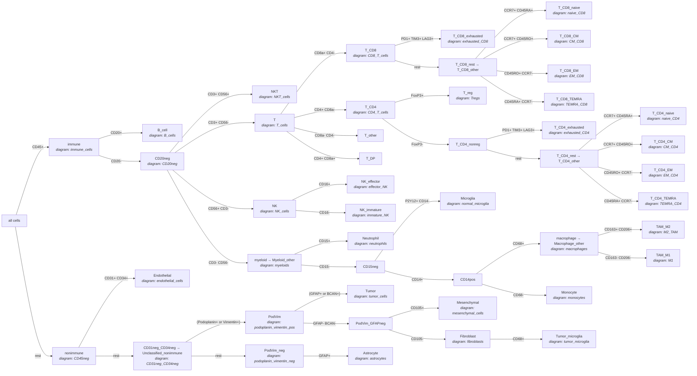

# Gating tree

Generated from `config/gating_tree.yaml` by `write_gating_mermaid()` (code/utils/gating_tree.R): do not edit by hand.
Edge text = gate applied to the cells of the parent (`+` positive, `-` negative, `rest` = cells not taken by an earlier sibling).

## Populations of the diagram not implemented

| Diagram | Reason |
|---|---|
| oligodendrocytes | OLIG2 not in the panel |

## Deviations from the diagram

Same rows as `06_gating_deviations.tsv` (step 06). Implementation = gates from the root (`>` = child of).

| Item | Diagram | Implementation | Reason |
|---|---|---|---|
| T | CD45+ -> CD3+ -> T cells | CD45+ > CD20- > CD3+ CD56- | Under CD20- and CD56- so that B, T and NKT cells (CD20- CD3+ CD56+) do not overlap |
| T_CD8 | CD8+ -> CD8+ T cells | CD45+ > CD20- > CD3+ CD56- > CD8a+ CD4- | CD4- so that CD8 and CD4 T cells do not overlap; CD4+ CD8+ T cells: node T_DP |
| T_CD8_other | CD8+ T cells -> CCR7 -> CD45RA/CD45RO (parallel to the exhausted branch) | CD45+ > CD20- > CD3+ CD56- > CD8a+ CD4- > rest | One label per cell: exhausted has priority, differentiation states only for the other CD8 T cells; CD8 T cells in no state are T_CD8_other. CCR7+ CD45RA+ CD45RO+: CM wins over naive; CCR7- CD45RA+ CD45RO+: TEMRA wins over EM |
| T_CD4 | CD4+ -> CD4+ T cells | CD45+ > CD20- > CD3+ CD56- > CD4+ CD8a- | CD8a- so that CD4 and CD8 T cells do not overlap; CD4+ CD8+ T cells: node T_DP |
| T_CD4_nonreg | CD4+ T cells -> Tregs \| activated \| exhausted, and (parallel) CCR7 -> CD45RA/CD45RO | CD45+ > CD20- > CD3+ CD56- > CD4+ CD8a- > FoxP3- | One label per cell: Tregs first, then exhausted, then differentiation states for the other FoxP3- CD4 T cells (Tregs get no differentiation state) |
| T_CD4_other | not in the diagram | CD45+ > CD20- > CD3+ CD56- > CD4+ CD8a- > FoxP3- > rest | FoxP3- non-exhausted CD4 T cells in no differentiation state |
| T_other | not in the diagram | CD45+ > CD20- > CD3+ CD56- > CD8a- CD4- | CD4- CD8- T cells (owner, 25/11) |
| T_DP | not in the diagram | CD45+ > CD20- > CD3+ CD56- > CD4+ CD8a+ | CD4+ CD8+ T cells: no label (Unclassified), as in 432d1c3 |
| NK | CD20- -> CD56+ -> NK cells | CD45+ > CD20- > CD56+ CD3- | CD3- so that NK and NKT cells do not overlap. NK cells must be CD45+: without it they would be 49% of the immune cells, as in the lab's counts, but 56% of CD56+ CD45- cells are GFAP+ or BCAN+ (glial) |
| Myeloid_other | CD3-/CD56- -> myeloids -> neutrophils \| microglia \| CD14+ | CD45+ > CD20- > CD3- CD56- | Myeloid cells in no branch of the diagram (CD15- CD14- P2Y12-) are Myeloid_other. 432d1c3 split their CD68+ part into M1 (by CD80, not in the diagram), M2 and Macrophage_other, and called the rest Other_immune |
| Microglia | CD14-/CD15- -> Iba1+ -> normal microglia | CD45+ > CD20- > CD3- CD56- > CD15- > P2Y12+ CD14- | Iba1 not in the shared panel (9/15 ROI): P2Y12+ instead (owner, 25/11); P2Y12 is specific for CNS-resident microglia |
| Macrophage_other | CD14+ -> Iba1+/CD68+ -> macrophages -> M1 \| M2 | CD45+ > CD20- > CD3- CD56- > CD15- > CD14+ > CD68+ | Iba1 not in the shared panel: CD68+ only; CD15- because neutrophils are taken first. Macrophages that are neither M1 (CD163- CD206-) nor M2 (CD163+ CD206+) are Macrophage_other |
| Monocyte | CD14+ -> Iba1-/CD68- -> monocytes | CD45+ > CD20- > CD3- CD56- > CD15- > CD14+ > CD68- | Iba1 not in the shared panel: CD68- only; CD15- because neutrophils are taken first |
| nonimmune | CD45- -> non-immune cells | rest | All cells not taken by `immune`: CD45- and CD45-flagged cells (if CD45 is flagged in > 30% of all cells, immune = CD3+ or CD68+ or CD56+, see immune_fallback) |
| Unclassified_nonimmune | CD31-/CD34- | rest > rest | All the other CD45- cells, also CD31+ CD34- and CD31- CD34+ (the lab's counts partition every gateway: their leaves add up to the parent). CD45- cells in no leaf are Unclassified_nonimmune |
| PodVim | podoplanin+/vimentin+ | rest > rest > (Podoplanin+ or Vimentin+) | Podoplanin+ OR vimentin+ (owner, 26/11; decision 0006): with AND tumor cells were 1-15% of the cells per patient; the podoplanin-/vimentin- branch is then exactly the complement. Reactive astrocytes (GFAP+ vimentin+) cannot be told apart from tumor without OLIG2 |
| Tumor | podoplanin+/vimentin+ -> GFAP+/OLIG2+ -> tumor cells | rest > rest > (Podoplanin+ or Vimentin+) > (GFAP+ or BCAN+) | OLIG2 not in the panel: GFAP+ OR BCAN+ (owner, 25/11); BCAN (brevican) is brain-specific |
| PodVim_GFAPneg | podoplanin+/vimentin+ -> GFAP-/OLIG2- -> CD105 | rest > rest > (Podoplanin+ or Vimentin+) > GFAP- BCAN- | OLIG2 not in the panel: GFAP- and BCAN- (complement of the tumor gate) |
| Fibroblast | CD105- -> fibroblasts; CD105- -> Iba1+/CD68+ -> tumor microglia | rest > rest > (Podoplanin+ or Vimentin+) > GFAP- BCAN- > CD105- | CD105- cells are fibroblasts unless tumor microglia (child node) |
| Tumor_microglia | CD105- -> Iba1+/CD68+ -> tumor microglia | rest > rest > (Podoplanin+ or Vimentin+) > GFAP- BCAN- > CD105- > CD68+ | Iba1 not in the shared panel: CD68+ only (as for macrophages) |
| PodVim_neg | podoplanin-/vimentin- | rest > rest > rest | All the other CD45- CD31-/CD34- cells: podoplanin- and vimentin- (complement of the OR gate above), and cells with both markers QC-flagged |
| Astrocyte | podoplanin-/vimentin- -> GFAP+/OLIG2- -> astrocytes | rest > rest > rest > GFAP+ | OLIG2 not in the panel: GFAP+ only (OLIG2- not checked: may include GFAP+ OLIG2+ tumor cells). GFAP- cells here (oligodendrocytes or other) are Unclassified_nonimmune |
| thresholds | not specified (the lab gates by hand in its software) | automatic: two-component GMM per patient (P85 fallback) or negative population per ROI (`thresholds`) | Not yet validated against the lab's populations (F4a, F14) |
| QC flags | not specified | a QC-flagged marker counts as negative in the tree and is NA in the T annotations | Marker not measurable in that ROI (constants.R QC_FLAGS) |
| T annotations | activated (HLA-DR+, Ki-67+ or both) for CD4 non-Tregs and CD8, alternative to exhausted | columns T_activated (HLA-DR+) and T_proliferating (Ki-67+) for every T label and NKT, independent of the label | Readouts that overlay the differentiation states |

