# Gating tree

Generated from `config/gating_tree.yaml` by `write_gating_mermaid()` (code/utils/gating_tree.R): do not edit by hand.
Edge text = gate applied to the cells of the parent (`+` positive, `-` negative, `rest` = cells not taken by an earlier sibling).

```mermaid
flowchart LR
  root["all cells"]
  immune["immune<br/><i>diagram: immune_cells</i>"]
  B_cell["B_cell<br/><i>diagram: B_cells</i>"]
  CD20neg["CD20neg<br/><i>diagram: CD20neg</i>"]
  NKT["NKT<br/><i>diagram: NKT_cells</i>"]
  T["T<br/><i>diagram: T_cells</i>"]
  T_CD8["T_CD8<br/><i>diagram: CD8_T_cells</i>"]
  T_CD8_exhausted["T_CD8_exhausted<br/><i>diagram: exhausted_CD8</i>"]
  T_CD8_rest["T_CD8_rest → T_CD8_other"]
  T_CD8_naive["T_CD8_naive<br/><i>diagram: naive_CD8</i>"]
  T_CD8_CM["T_CD8_CM<br/><i>diagram: CM_CD8</i>"]
  T_CD8_EM["T_CD8_EM<br/><i>diagram: EM_CD8</i>"]
  T_CD8_TEMRA["T_CD8_TEMRA<br/><i>diagram: TEMRA_CD8</i>"]
  T_CD4["T_CD4<br/><i>diagram: CD4_T_cells</i>"]
  T_reg["T_reg<br/><i>diagram: Tregs</i>"]
  T_CD4_nonreg["T_CD4_nonreg"]
  T_CD4_exhausted["T_CD4_exhausted<br/><i>diagram: exhausted_CD4</i>"]
  T_CD4_rest["T_CD4_rest → T_CD4_other"]
  T_CD4_naive["T_CD4_naive<br/><i>diagram: naive_CD4</i>"]
  T_CD4_CM["T_CD4_CM<br/><i>diagram: CM_CD4</i>"]
  T_CD4_EM["T_CD4_EM<br/><i>diagram: EM_CD4</i>"]
  T_CD4_TEMRA["T_CD4_TEMRA<br/><i>diagram: TEMRA_CD4</i>"]
  T_other["T_other"]
  T_DP["T_DP"]
  NK["NK<br/><i>diagram: NK_cells</i>"]
  NK_effector["NK_effector<br/><i>diagram: effector_NK</i>"]
  NK_immature["NK_immature<br/><i>diagram: immature_NK</i>"]
  myeloid["myeloid<br/><i>diagram: myeloids</i>"]
  Neutrophil["Neutrophil<br/><i>diagram: neutrophils</i>"]
  CD15neg["CD15neg"]
  Microglia["Microglia<br/><i>diagram: normal_microglia</i>"]
  CD14pos["CD14pos"]
  macrophage["macrophage<br/><i>diagram: macrophages</i>"]
  TAM_M2["TAM_M2<br/><i>diagram: M2_TAM</i>"]
  TAM_M1["TAM_M1<br/><i>diagram: M1</i>"]
  Monocyte["Monocyte<br/><i>diagram: monocytes</i>"]
  CD14neg_P2Y12neg["CD14neg_P2Y12neg"]
  CD68pos_other["CD68pos_other"]
  TAM_M2_CD14neg["TAM_M2_CD14neg → TAM_M2"]
  TAM_M1_CD14neg["TAM_M1_CD14neg → TAM_M1"]
  Macrophage_other["Macrophage_other"]
  Other_immune["Other_immune"]
  nonimmune["nonimmune<br/><i>diagram: CD45neg</i>"]
  Endothelial["Endothelial<br/><i>diagram: endothelial_cells</i>"]
  CD31neg_CD34neg["CD31neg_CD34neg<br/><i>diagram: CD31neg_CD34neg</i>"]
  Tumor["Tumor<br/><i>diagram: tumor_cells</i>"]
  stromal_pool["stromal_pool → Unclassified_nonimmune"]
  PodVim["PodVim<br/><i>diagram: podoplanin_vimentin_pos</i>"]
  Mesenchymal["Mesenchymal<br/><i>diagram: mesenchymal_cells</i>"]
  Fibroblast["Fibroblast<br/><i>diagram: fibroblasts</i>"]
  Stromal["Stromal"]
  root -->|"CD45+"| immune
  immune -->|"CD20+"| B_cell
  immune -->|"CD20-"| CD20neg
  CD20neg -->|"CD3+ CD56+"| NKT
  CD20neg -->|"CD3+ CD56-"| T
  T -->|"CD8a+ CD4-"| T_CD8
  T_CD8 -->|"(PD1+ or TIM3+ or LAG3+)"| T_CD8_exhausted
  T_CD8 -->|"PD1- TIM3- LAG3-"| T_CD8_rest
  T_CD8_rest -->|"CCR7+ CD45RA+"| T_CD8_naive
  T_CD8_rest -->|"CCR7+ CD45RO+"| T_CD8_CM
  T_CD8_rest -->|"CD45RO+ CCR7-"| T_CD8_EM
  T_CD8_rest -->|"CD45RA+ CCR7-"| T_CD8_TEMRA
  T -->|"CD4+ CD8a-"| T_CD4
  T_CD4 -->|"FoxP3+"| T_reg
  T_CD4 -->|"FoxP3-"| T_CD4_nonreg
  T_CD4_nonreg -->|"(PD1+ or TIM3+ or LAG3+)"| T_CD4_exhausted
  T_CD4_nonreg -->|"PD1- TIM3- LAG3-"| T_CD4_rest
  T_CD4_rest -->|"CCR7+ CD45RA+"| T_CD4_naive
  T_CD4_rest -->|"CCR7+ CD45RO+"| T_CD4_CM
  T_CD4_rest -->|"CD45RO+ CCR7-"| T_CD4_EM
  T_CD4_rest -->|"CD45RA+ CCR7-"| T_CD4_TEMRA
  T -->|"CD8a- CD4-"| T_other
  T -->|"CD4+ CD8a+"| T_DP
  CD20neg -->|"CD56+ CD3-"| NK
  NK -->|"CD16+"| NK_effector
  NK -->|"CD16-"| NK_immature
  CD20neg -->|"CD3- CD56-"| myeloid
  myeloid -->|"CD15+"| Neutrophil
  myeloid -->|"CD15-"| CD15neg
  CD15neg -->|"P2Y12+ CD14-"| Microglia
  CD15neg -->|"CD14+"| CD14pos
  CD14pos -->|"CD68+"| macrophage
  macrophage -->|"(CD163+ or CD206+)"| TAM_M2
  macrophage -->|"CD163- CD206-"| TAM_M1
  CD14pos -->|"CD68-"| Monocyte
  CD15neg -->|"CD14- P2Y12-"| CD14neg_P2Y12neg
  CD14neg_P2Y12neg -->|"CD68+"| CD68pos_other
  CD68pos_other -->|"(CD163+ or CD206+)"| TAM_M2_CD14neg
  CD68pos_other -->|"CD80+ CD163- CD206-"| TAM_M1_CD14neg
  CD68pos_other -->|"CD163- CD206- CD80-"| Macrophage_other
  CD14neg_P2Y12neg -->|"CD68-"| Other_immune
  root -->|"rest"| nonimmune
  nonimmune -->|"(CD31+ or CD34+)"| Endothelial
  nonimmune -->|"CD31- CD34-"| CD31neg_CD34neg
  CD31neg_CD34neg -->|"(GFAP+ or BCAN+)"| Tumor
  CD31neg_CD34neg -->|"GFAP- BCAN-"| stromal_pool
  stromal_pool -->|"Podoplanin+ Vimentin+"| PodVim
  PodVim -->|"CD105+"| Mesenchymal
  PodVim -->|"CD105-"| Fibroblast
  stromal_pool -->|"Vimentin+ Podoplanin-"| Stromal
```

## Populations of the diagram not implemented

| Diagram | Reason |
|---|---|
| oligodendrocytes | OLIG2 not in the panel |
| astrocytes | OLIG2 not in the panel; GFAP+ cells are called Tumor |
| tumor_microglia | Iba1 not in the shared panel (possible with P2Y12+/CD68+ in the non-immune branch: to decide) |
| podoplanin_vimentin_neg | Only leads to oligodendrocytes and astrocytes |

